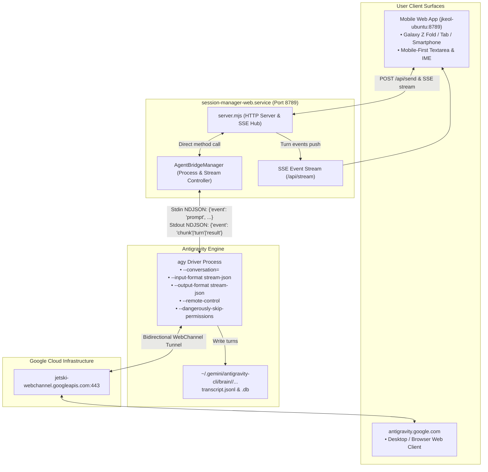

# Antigravity API Bridge & Bidirectional Synchronization Design Specification

- **Date**: 2026-10-19
- **Project**: N100 Session Manager (`ttolmany.session-manager`)
- **Version Target**: v1.5.0
- **Status**: Approved by User & Ready for Implementation Planning

---

## 1. Overview & Problem Statement

### 1.1 Background & Root Cause
In previous versions of `session-manager`, when a user sent a prompt from the mobile web UI (`jkeol-ubuntu:8789`), `server.mjs` used `tmux paste-buffer` and `tmux send-keys` to inject text into a local CLI session (`agy --conversation=<cid>`).
This caused two critical failures:
1. **Asymmetric Sync Failure**: The background daemon (`antigravity-cli-daemon.service`) was connected to `antigravity.google.com`, but the local tmux CLI session was launched without `--remote-control` (`[RemoteControl] Session toggle is off, staying disconnected`). Turns generated by the local CLI never reached Google Cloud, so `antigravity.google.com` never updated.
2. **Database Concurrency Collision (Split-Brain)**: When both the background daemon and the local tmux CLI wrote to the same SQLite database (`~/.gemini/antigravity-cli/conversations/<cid>.db`), step indices were overwritten (e.g. user prompt overwritten at step 139), corrupting conversation history.

### 1.2 Core Goals & Success Criteria
1. **100% Bidirectional Synchronization**:
   - Prompts sent from Mobile Web (`8789`) immediately stream responses to both Mobile Web and `antigravity.google.com`.
   - Prompts sent from `antigravity.google.com` immediately stream responses to both `antigravity.google.com` and Mobile Web.
   - Zero split-brain or database step index corruption.
2. **Mobile-First Text Editing Ergonomics**:
   - Proper `<textarea>` with Korean IME support (`isComposing`), preventing double characters or split jamo.
   - Multiline typing with autogrow (1 to 5 rows).
   - Virtual keyboard integration (`visualViewport`) preventing composer or chat history from being obscured.
   - Attachment upload, thumbnail preview, and removal.
3. **antigravity.google.com Visual & Functional Parity**:
   - Exact dark color palette (`#131314` base, `#1e1f20` cards, `#2b2c2e` borders, `#7cacf8` accents).
   - Unified collapsible accordion combining Thinking process and Tool execution.
   - Markdown syntax highlighting with touch-friendly 1-tap copy buttons.
   - Direct link (`🌐 Google Web`) in the header connecting to `antigravity.google.com/r/<session-id>`.

---

## 2. Architecture & Data Flow



### 2.1 AgentBridgeManager Specification
Instead of spawning tmux sessions and sending raw keys via `tmux send-keys`, `server.mjs` incorporates `AgentBridgeManager`:

1. **Process Lifecycle**:
   - Maintains an in-memory map of active AGY worker processes keyed by conversation ID (`cid`).
   - For a given `cid`, launches a persistent driver:
     ```bash
     agy --conversation=<cid> \
         --input-format stream-json \
         --output-format stream-json \
         --remote-control \
         --dangerously-skip-permissions
     ```
   - Auto-restarts worker on unexpected exit, and idles out after inactivity (e.g., 30 minutes of no traffic) to preserve server memory.

2. **Sending User Prompts (`POST /api/send`)**:
   - `AgentBridgeManager.sendPrompt(cid, text, attachments)` writes an NDJSON message to the worker's `stdin`:
     ```json
     {"event": "prompt", "prompt": "<user text>"}
     ```
   - The worker executes the prompt:
     - Output is streamed to `stdout` in NDJSON format.
     - Simultaneously, because `--remote-control` is active, the worker streams every chunk, thought, and tool execution directly to Google Cloud over its WebChannel tunnel.
     - As a result, `antigravity.google.com` displays the prompt and live response immediately.

3. **Receiving Remote Prompts**:
   - If the user types in `antigravity.google.com`, the worker receives the prompt over WebChannel and emits events on `stdout` and appends to `transcript.jsonl`.
   - `server.mjs` pushes these new turns to the mobile web app via SSE `/api/stream`.

4. **Terminal / Claude / Codex Compatibility**:
   - Existing tmux sessions (`Tax_Asset`, `Fishing`, Claude Code, Codex, shell) continue using the PTY / tmux bridge as before.
   - Only `agy` and `rc_*` sessions are handled by `AgentBridgeManager`.

---

## 3. Mobile UI & Composer Enhancements

### 3.1 Input Editing Ergonomics (`public/mobile.js` & `public/mobile.css`)
- **IME Safe Handler**:
  - `composerInput.addEventListener('compositionstart', () => { isComposing = true; })`
  - `composerInput.addEventListener('compositionend', () => { isComposing = false; })`
  - `keydown` handler checks `e.isComposing || e.keyCode === 229` to avoid premature submissions.
- **Autogrow Textarea**:
  - Dynamically recalculates height based on `scrollHeight` up to `160px` (~5 lines).
- **Virtual Keyboard Awareness**:
  - `window.visualViewport.addEventListener('resize')` smoothly offsets `#composer` so it always stays docked above the soft keyboard.
- **Send Mode Toggle**:
  - Icon toggle in the composer: Mode 1 (Enter sends, Shift+Enter newline), Mode 2 (Enter adds newline, explicit Send button tap required).

### 3.2 Visual Look & Feel
- **Theme Variables**:
  ```css
  --bg-primary: #131314;
  --bg-secondary: #1e1f20;
  --bg-tertiary: #2b2c2e;
  --accent: #7cacf8;
  --text-primary: #e3e3e3;
  --text-secondary: #8e918f;
  --border-subtle: #313538;
  ```
- **Unified Work Process Accordion**:
  - Thinking blocks and tool executions are bundled into a single collapsible card with status indicator (⏳ In progress / ✅ Completed) matching Google Web.
- **Header Remote Link**:
  - Next to session title, display `[🌐 Google Web]` button which opens `https://antigravity.google.com/r/<session-id>` in a new tab.

---

## 4. Verification & Testing Plan

1. **Unit & Protocol Verification**:
   - Verify `stream-json` handshake and prompt execution with `agy`.
   - Verify NDJSON parser in `server.mjs`.
2. **Bidirectional End-to-End Tests**:
   - **Test 1 (Mobile ➔ Google)**: Send message from mobile web (`8789`), verify it appears on `antigravity.google.com` in real time.
   - **Test 2 (Google ➔ Mobile)**: Send message from `antigravity.google.com`, verify it appears on mobile web (`8789`) in real time.
   - **Test 3 (Mobile IME & Editing)**: Test Korean typing, multiline Shift+Enter, attachment upload, and backspace behavior on mobile browser.
   - **Test 4 (Non-AGY Regression)**: Verify Claude (`Tax_Asset`) and shell tmux sessions continue to work seamlessly through the existing terminal bridge.
